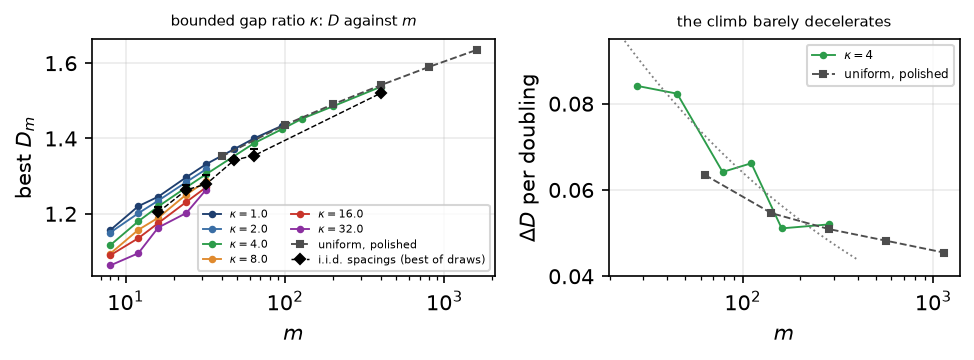

# Uneven parameter spacings — preliminary

**Notation.** In `notes/koch-extremals.tex` $\rho$ is the distortion ratio $|F(x)-F(y)|/|x-y|^\alpha$;
here $\kappa$ is used for the *gap ratio* $\max\Delta x/\min\Delta x$, to keep the two apart.

**Status.** Preliminary, deliberately not in either note (`notes/improving-koch-extremals.tex` had a
paragraph and figure on this and they were removed on 2026-11-16; the history still has them). To be
written up only once we agree what the facts are. Scripts: `scripts/optimise_uneven.py`,
`scripts/uneven_spacing.py`, `scripts/analyse_random_spacing.py`, `scripts/plot_uneven.py`,
`scripts/plot_uneven_random.py`. Data: `results/uneven-*.json`, `results/uneven_*.npz`.
Figures: `figures/uneven-spacing.png`, `figures/uneven-random-shapes.png`,
`figures/uneven-random-diagnostics.png`.

The problem with free parameters: $0=x_0<\dots<x_{m-1}=1$ and $v_i\in\mathbb{C}$, minimise the
spread of $r_{ij}=|v_i-v_j|/(x_j-x_i)^\alpha$ over all pairs.

## 1. Free spacings are degenerate

Three points already give $D=1$ exactly (a triangle with sides $c,c,2^\alpha c$ exists, with
$c=3^{-\alpha}$). Splitting them into near-duplicates — $\varepsilon$ apart in parameter and
$c\,\varepsilon^\alpha$ apart in space — keeps every ratio at 1, so the infimum is $1$ for every
$m\ge3$, approached only as the duplicates coalesce, and no curve is approximated. The optimiser
finds exactly this: $D=1.0008$ at $m=6$, gaps from $2.5\times10^{-5}$ to $0.56$, the six points in
three pairs. **The free problem is empty**; every statement below needs a constraint on the gaps.

## 2. Bounded gap ratio $\kappa=\max\Delta x/\min\Delta x$

$\kappa=1$ is the uniform ladder. For each fixed $\kappa$ the compactness argument still gives
$D_m(\kappa)\to D_\infty$, since comparable gaps keep the parameters asymptotically uniform.

```
          m=8      m=12     m=16     m=24     m=32     m=48     m=64     m=96
 rho=1   1.15661  1.22013  1.24535  1.29708  1.33192  1.37189  1.40031  1.43403
 rho=2   1.15012  1.20140  1.23488  1.28427  1.31850
 rho=4   1.11664  1.18004  1.21941  1.27031  1.30524
 rho=8   1.09427  1.15733  1.18935  1.25117  1.28663
 rho=16  1.08978  1.13516  1.17524  1.23142  1.27044
 rho=32  1.06277  1.09517  1.16348  1.20199  1.26423
```

Unevenness lowers every rung by a few per cent. The optimal spacings are *hierarchical*, not smooth:
at $\kappa=32$, $m=32$ the gaps alternate between $0.0026$ and $0.082$ — clusters of near-duplicates
separated by jumps of the maximal size (`figures/uneven-spacing.png`, right panel). Imposing a smooth
profile instead is catastrophic: $x_i=(i/(m-1))^{1/2}$ gives $D=5.14$ at $m=12$ and
$x_i=(i/(m-1))^{2}$ gives $11.16$, against $1.22$ for uniform. It is the *structure* of the
unevenness that matters, not its size.

## 3. Random fixed spacings

$x_i$ = sorted uniform random, then frozen; only the positions are optimised. Three draws,
$m=16\dots64$.

```
   m     uniform    draw 0    draw 1    draw 2      gap ratio (draws)
  16     1.24535   1.21758   1.20414   1.21832      47 - 288
  24     1.29708   1.26336   1.26667   1.27676      48 - 216
  32     1.33192   1.29296   1.27874   1.30292     212 - 2199
  48     1.37189   1.34271   1.34781   1.34688     155 - 1934
  64     1.40031   1.36897   1.35468   1.37138      86 - 1319
```

Two things. **Random spacings beat the uniform grid at every $m$**, by 2–3%: the uniform
parametrisation is a poor sampling of the extremal curve, not the best $m$-point sampling. And the
values still increase with $m$, as they must ($D_m\le D_{m+1}\le D_\infty$).

**The shapes do not separate.** `figures/uneven-random-shapes.png` shows draw 0 at $m=16,32,64$
against the $m=800$ uniform configuration (grey). The coarse configuration is a polygon whose
vertices sit on the same S profile; by $m=64$ the points hug it. No second shape appears.

Quantitatively, with the conjugation ambiguity resolved by taking the better of $v$ and $\bar v$:

* max distance from a configuration to the $m=800$ polyline: random draws $0.045$–$0.11$
  (mean $0.013$–$0.053$); uniform rungs $0.034$–$0.12$ (mean $0.010$–$0.051$). The same range,
  falling with $m$ in both (`figures/uneven-random-diagnostics.png`, right).
* shape distances (max point-to-polyline, both directions) between the three $m=64$ draws:
  $0.068$, $0.069$, $0.081$. Between a draw and the uniform $m=64$: $0.054$, $0.081$, $0.085$.
  Between uniform rungs themselves ($m=96$ vs $m=800$): $0.054$.

So at these $m$ all the configurations, uniform and uneven, sit in one shape class to within
$0.05$–$0.08$ of the diameter: the same S profile, unevenly sampled and further along.

**A caution about the test.** "Qualitatively different from the exactly self-similar curves we have
looked at" would not by itself indicate a new type of optimum: the *uniform* S family is already not
self-similar in the measured sense (best sub-arc similarity residual $0.13$,
`results/shortening-similarity.md`). Differing from Koch, the two-piece and the three-piece arcs is a
property of the S branch already.

## 4. Caveats, and what would settle it

* All values are local optima from a few starts. At fixed $\kappa$ they are not monotone in $m$
  ($\kappa=32$: $1.0628$ at $m=8$, $1.0952$ at $m=12$), which cannot happen for exact optima. Seeding
  $m=12,16$ from the $m=8$ optimum improves them slightly ($1.1352\to1.1223$, $1.1635\to1.1516$) but
  not to $1.0628$.
* The shape test is limited by not knowing the limit curve: the uneven configurations are *better*
  than the $m=800$ uniform one, so they cannot coincide with it, and the distance to it is a crude
  proxy.
* What would decide it: run the random-spacing family to $m\approx200$–$400$ and see whether the
  pairwise shape distances keep falling ($0.07$ at $m=64$, against $0.054$ between uniform rungs at
  $m\ge96$); or compare sampling *densities* (the parameter measure) rather than point sets; or run
  the sub-arc self-similarity diagnostic directly on the uneven optima, which is the test that
  distinguishes "a different kind of optimum" from "a different sampling of the same curve".

## 5. Is the gain "just the prevalence of large arcs"?

Suggested hypothesis: at fixed $m$ an uneven parametrisation might win simply because it offers
long parameter spans whose ratios are slack, i.e. because "large arcs" are prevalent. The data says
no, on three counts (all at $m=32$ unless stated).

**The optimiser does not make large arcs.** At $\kappa=32$ the longest gap is $2.5\times$ the mean gap
($0.082$ against $0.032$) and the shortest is $0.08\times$: it *clusters* points, it does not open
long arcs. Across $m=8\dots32$ at $\kappa=32$ the largest gap is $2.4$–$4.8\times$ the mean.

**The gain does not need them.** Gaps confined to $[0.65,1.4]\times$ the mean ($\kappa=2$, so no long
arcs at all) already recover $7$–$20\%$ of the $\kappa=1\to32$ gain, $\kappa=4$ recovers $28$–$43\%$ and
$\kappa=16$ recovers $68$–$91\%$; the gain grows roughly linearly in $\log\kappa$ with no threshold.

**The binding pairs are not the long ones.** At $m=32$:

```
                     D        max r at span   min r at span    r over spans<0.05   r over spans>0.5
 uniform          1.33192    0.387 (1.1x)     0.452 (1.3x)       0.789-0.938        0.789-1.050
 rho=2            1.31850    0.641 (1.8x)     0.535 (1.5x)       0.787-0.924        0.787-1.038
 rho=32           1.26423    0.805 (1.9x)     0.538 (1.2x)       0.825-1.043        0.825-1.043
 random draw 0    1.29296     -                -                  0.804-1.038        0.804-1.039
```

(spans in ordinary units, with "x" the span divided by the mean span of all pairs.)

The binding ratios sit at spans of $1.1$–$1.9\times$ the mean in every case --- never at the longest
arcs --- and the long-span ratios are if anything *narrower* than the rest, not slack in a way that
helps.

**What the gain actually is.** It is a rise of the *minimum* ratio: the smallest ratio goes from
$0.789$ (uniform) to $0.825$ ($\kappa=32$), while the largest barely moves ($1.050\to1.043$). In the
uniform optimum the short-span pairs sit at the bottom of the ratio range ($0.789$--$0.938$ for spans
below $0.05$, against $1.050$ for long spans): the small-scale chords are systematically too short.
Uneven spacing lets the finite configuration place its points so that short and long spans have the
*same* ratio range ($0.825$--$1.043$ in both), i.e. it equalises across scales at fixed $m$, which the
uniform grid blocks. The correlation between $\log$ span and $\log$ ratio barely changes
($+0.54$ uniform, $+0.48$ at $\kappa=32$), so this is a shift of the ratio range, not a change of
structure.

In short: the lower $D$ is a *sampling* effect, as suspected, but the mechanism is the extra freedom
to place the points (which removes a scale bias), not the presence of long arcs. Since every fixed
$\kappa$ still has $D_m(\kappa)\to D_\infty$, it buys rate of convergence, not a different limit.
Caveat: this diagnostic is at $m=32$; it should be repeated at the largest $m$ we can afford.

## 6. Larger tests: how should the nodes be placed?

Measured at $m=32$ and $m=64$ with the positions optimised in every case (two restarts each), on the
same objective:

```
                        m=32      m=64     gain vs uniform (m=32 / m=64)
 uniform grid          1.33242   1.40031   --
 jittered, one node
 per stratum (3 seeds) 1.31787   1.39011   1.1% / 0.7%
                       1.32392   1.39341   0.6% / 0.5%
                       1.32308   1.39243   0.7% / 0.6%
 iid uniform (3 draws) 1.27874   1.35468   4.0% / 3.3%
                       1.29296   1.36897   3.0% / 2.2%
                       1.30292   1.37138   2.2% / 2.1%
 smooth warp gamma=0.95 1.33338 1.39982   ~0
 smooth warp gamma=1.10 1.33311 1.40081   ~0
```

Read off:

* **i.i.d. draws are not the right instrument for a study of the optimum.** They are a typical
  sampling, but the optimised $D$ then scatters by about $1\%$ between draws --- the same size as
  the effects one wants to resolve --- and most of that scatter is sampling noise, not geometry.
* **Jittering/repelling the nodes** (one node per stratum, so the gaps stay within a factor of a few)
  reduces the scatter to about $0.5\%$, but it also gives back most of the gain: it pushes the
  sampling back towards uniform.
* **Smooth changes of density do nothing.** Warps $x_i=(i/(m-1))^\gamma$ with $\gamma$ within $10\%$
  of 1 (gap ratio 1.25--1.7) reproduce the uniform value to four digits. The gain is *local*
  unevenness (clusters), not a global reweighting.

What matters is the sampling *density* (the empirical measure), not the individual gaps. Hence, for
larger tests: use a **deterministic** grid --- either a quantile grid of a density,
$x_i=Q(i/(m-1))$, or better, the $\kappa$-bounded family already implemented ($\kappa=4$ or $8$,
grown in $m$). That is noise-free, stays non-degenerate (so $D_m\to D_\infty$ by compactness applies),
and lets the optimiser put the local unevenness where it wants it.

## 7. Does coupled annealing in $(\beta,m)$ reach $D_\infty$?

Partly, and not on its own.

* **The coupling is mild.** The surrogate is a log-sum-exp over $m(m-1)/2$ pairs, so its bias is
  $O(\log m/\beta)$: for a fixed relative accuracy $\varepsilon$ one needs $\beta\gtrsim2\log m/\varepsilon$.
  $\beta$ should grow like $\log m$, not like $m$. Annealing $\beta$ is what makes each level
  optimisable from the previous one; it does not sharpen the answer beyond $\varepsilon$.
* **It does not remove the real difficulty,** which is that the number of local minima grows with $m$
  and that the algorithm is a descent method at each level. The exact values $D_m$ are what converge
  ($D_m\uparrow D_\infty$), so a coupled scheme is only as good as the optimisation at each $m$
  (in practice: double $m$, interpolate, polish with the SLP to a KKT point).
* **It must not be run on free spacings.** The free problem's infimum is $1$ for every $m$
  (\S1), so a $(\beta,m)$ annealing with free spacings converges to the degenerate value $1$, not to
  $D_\infty$. It has to live in a non-degenerate class: uniform, or gap ratio bounded, or a fixed
  asymptotic density.
* **Extrapolation in $m$ is not usable yet.** The ladder's increments per doubling are
  $0.084, 0.055, 0.051, 0.048, 0.046$ --- decaying by only $0.94$ per doubling. A power-law fit
  $D_m=D_\infty-cm^{-s}$ to the six rungs gives $D_\infty=2.16$, $s=0.116$, residuals $\sim10^{-3}$
  --- and $2.16$ exceeds the proved Koch ceiling $2.0968$, so the fit is impossible and the ladder is
  in a transient. No extrapolation from $m\le1600$ can settle the continuum value.

So: the sensible version of the idea is "$\beta\sim\log m$, $m$ doubling, exact (or certified)
polishing at each level, inside a non-degenerate spacing class", and it delivers a *sequence of
bounds*, not the limit. For the actual continuum value the more promising route is the continuum
stationarity structure (stress measure, variational inequality) that the earlier sessions started,
with a refinement scheme that inserts points where the stress concentrates --- that converges to a
stationary point of the continuum problem rather than crawling up the $m$-ladder.

## 8. The $\kappa=4$ family at large $m$ (200, 400)

Deterministic, warm-started (`scripts/uneven_large.py`, results `results/uneven_k4_m*.npz`,
`results/uneven-kappa4-large.json`, `results/uneven-kappa4-m400.json`). Gaps and positions both
optimised, gap ratio bounded by 4; every run uses the full bound (gap ratio 3.45–3.69), so the
constraint is active, not a near-uniform optimum.

```
   m       32        64        96        128       200       400
 kappa=4  1.30524   1.38756   1.42510   1.45258   1.48548   1.53749
 uniform  1.33192   1.39536*  1.43403   -         1.49086   1.54179
 gain     3.6%      0.56%     0.52%     -         0.36%     0.28%
```
(*interpolated in $\log m$ between the uniform rungs.)

* The gap between the two families **shrinks**: $3.6\%$ at $m=32$, $0.5$–$0.6\%$ at $m=64$–96,
  $0.2$–$0.4\%$ at $m=128$–400. So the unevenness buys a *transient* advantage, as it must if both
  families converge to the same $D_\infty$.
* **The increments do not decay faster.** Per doubling of $m$: $\kappa=4$ gives
  $0.082, 0.064, 0.066, 0.051, 0.052$; the uniform ladder gives $0.064, 0.055, 0.051, 0.048, 0.046$.
  At matched $m$ the two are the same to about $0.005$; the $\kappa=4$ ladder simply sits lower.
* **Extrapolation.** A fit $D_m=D_\infty-cm^{-s}$ gives, for $\kappa=4$,
  $D_\infty=1.768$, $c=1.19$, $s=0.273$, residuals $\le0.0025$; for the uniform ladder
  $D_\infty=2.161$, $s=0.116$, which is **inadmissible** ($2.161>2.0968$, the proved Koch ceiling).
  The $\kappa=4$ extrapolation is plausible but should not be trusted: the model is arbitrary, the
  residuals are comparable to the whole gap between the families, and $s$ is fitted to five points.
  What it does say is that the uniform ladder is in a regime where extrapolation cannot be used at
  all, while a bounded-unevenness ladder is not.
* **Noise.** Repeated runs at $m=200$ differ by $0.0016$ ($1.48380$ against $1.48548$), i.e. $0.1\%$;
  the $m=400$ value is a single run. So the $0.2$–$0.4\%$ gaps at large $m$ are at the edge of what
  this optimiser resolves, and the trend (shrinking gap) is the part to trust, not the individual
  numbers.

## 9. What exactly is the "stress measure"

Two levels; the finite one is implemented (`slp2.stress`), the continuum one is a programme.

**Finite $m$.** Free coordinates $x\in\mathbb{R}^{2(m-2)}$ (positions after the similarity gauge), and
for each pair $a=(i,j)$ the log-ratio $L_a(x)=\log r_{ij}=\log|v_i-v_j|-\alpha\log|i-j|$. The problem
$\min_x\ \max_a L_a-\min_b L_b$ has the KKT conditions: there are weights
$\lambda\in\Delta(E^+)$, $\mu\in\Delta(E^-)$ on the tight sets
$E^+=\{a:L_a=\max L\}$, $E^-=\{b:L_b=\min L\}$ with
\[
  \sum_{a\in E^+}\lambda_a\nabla L_a \;=\; \sum_{b\in E^-}\mu_b\nabla L_b ,
\]
and each $\nabla L_a$ is supported on the two endpoints of $a$ with value
$\pm(v_i-v_j)/|v_i-v_j|^2$ — a unit vector along the chord divided by its length. So the certificate
is a *pair of probability measures on the tight pairs* whose fields balance at every free vertex:
$\lambda$ pulls along the longest chords, $\mu$ pushes along the shortest. `slp2.stress` solves
exactly this feasibility LP (status 0 = a certificate exists); that is what "first-order certified"
means in Table 1. At $m=200$ it is $48+346$ pairs, at $m=400$ it is $80+695$ (arc branch) — thousands
of coefficients, so the measures are far from unique.

**Continuum.** A pair of Borel probability measures $\sigma^+$ on $[0,1]^2$ supported on
$E^+=\{(x,y):r(x,y)=M\}$ and $\sigma^-$ supported on $E^-=\{(x,y):r(x,y)=m_0\}$, such that for every
test field $\psi\in C_c((0,1);\mathbb{R}^2)$
\[
  \iint \psi(x)\cdot\Phi(x,y)\,d\sigma^+(x,y) \;=\; \iint \psi(x)\cdot\Phi(x,y)\,d\sigma^-(x,y),
  \qquad \Phi(x,y)=\frac{\gamma(x)-\gamma(y)}{|\gamma(x)-\gamma(y)|^2},
\]
i.e. the first variation of $M$ and of $m_0$ agree in every direction — the curve is a stationary
point of the minimax. Equivalently, with $\sigma=\sigma^+-\sigma^-$, the stress field
$S(x)=\int\Phi(x,y)\,d\sigma_x(y)$ vanishes (Lebesgue-a.e. $x$), where $\sigma_x$ is the
disintegration at $x$.

Two points of care. (i) $|\Phi|\sim|x-y|^{-\alpha}\to\infty$ on the diagonal, so the integrals are
principal values: the equation only makes sense if $\sigma^+$ and $\sigma^-$ have matching
short-distance behaviour near $y=x$. That is not an artefact — the numerics show the extrema
recurring at *every* scale (contiguous blocks of the $m=400$ configuration reproduce $D$ to
$1.2\times10^{-13}$), so mass genuinely accumulates on the diagonal, and the balance has to be
imposed scale by scale. (ii) The multipliers are not unique at these $m$ (thousands of tight pairs,
highly degenerate LP), so the continuum statement requires a canonical selection — the earlier
session used a least-TV selection; weak-* convergence of the selected measures along a
shape-compatible branch is the test that was proposed and not carried out
(`results/limiting_curve_directions.md`).

**What one would do with it.** Compute $(\lambda,\mu)$ at each $m$ (a small LP), read the marginals
on the index $i$, and insert points where the marginal mass or the residual $|S(x)|$ is largest:
an adaptive refinement driven by the stress, which converges to a stationary curve instead of
crawling up the $m$-ladder. Nothing of this is carried out; the finite LP is the only part that
exists in code.

## 10. Is there a stress for the Koch curve?

The stress is a KKT certificate: if it exists, no first-order variation of the curve lowers $D$, and
by Farkas the converse holds, so *stress exists* $\iff$ *no first-order descent direction*. It
certifies local optimality in the space of curves; it says nothing about other branches, and at a
non-smooth min like this one the directional derivative is typically *positive* in most directions,
so "D increases in every direction I tried" is consistent with stationarity and decides nothing.
The only test is the LP (finite) or its continuum analogue.

**Finite level: no certificate, and explicit descent.** At every dyadic level the Koch polygon
(parameters $x_i=i/4^k$, so exactly the uniform-index configuration of $m=4^k+1$) fails the LP, and
the imbalance is not small — `scripts/stress_residual.py` minimises the L1 residual of
$\sum\lambda_a A_a=\sum\mu_b A_b$ over $\lambda,\mu\ge0$, $\sum\lambda=\sum\mu=1$ and divides by the
mean row norm of $A$:

```
 level  m      D            residual   #max  #min   D after 1 SLP step   after 5
   2    17    2.083010     1.953       6     1        2.080516            2.007973
   3    65    2.089552     1.784       6     8        2.088688            2.062924
   4    257   2.093439     1.106       6     39       2.092876            2.080642
   5    1025  2.0968052    1.080      12     166      -                   -
   6    4097  2.0968052    0.405      72     677      -                   -
```

The residual is insensitive to the tolerance defining the tight sets ($10^{-6}$ to $10^{-10}$ give
identical values) and to nothing else, so the sets really are tight. So at every level tested the
Koch polygon is *not* a local minimum of the finite-$m$ problem, and the SLP reduces $D$ at once.

**But that is a different condition.** The finite-$m$ gradient sees only *node* pairs, while the
continuum sup is over all pairs; a discrete descent direction can leave the continuum functional
untouched (or worse). And the residual *falls* under refinement, $1.95,1.78,1.11,1.08,0.41$, as the
extremal sets grow ($6\to12\to72$ max pairs, $1\to677$ min pairs) and give the multipliers more room.
So the finite data are **inconclusive** about the continuum.

**A two-parameter family test, also inconclusive.** Four-piece self-similar arcs with weights
$w=(w_1,w_2,w_2,w_4)$, sidelengths $r_i=w_i^{\alpha}$ and Koch directions $(0,\theta,-\theta,0)$,
closure forcing $\cos\theta=(1-r_1-r_4)/(r_2+r_3)$: the Koch curve is $w=(1/4,\dots,1/4)$. At level
6, $D$ increases in every direction tried, with slopes $\partial D/\partial w_1\approx+3.7$,
$+7.5$ along $(w_1,w_4)=(1,1)$ and $+0.05$ along the anti-diagonal $(1,-1)$: so the Koch curve is a
local minimum *within this family*, pointy rather than smooth. That is what a KKT point that is not
smooth looks like, so it does not answer the question either.

**What would.** The Koch extremal pairs are explicit (the orbit of the two seeds under the four
maps, at all scales), so a continuum stress would be a *self-similar pair of measures* on their
addresses, and the balance at a test point becomes a countable linear system obtained by
renormalisation: the same kind of computation as the companion note's two-sided proof, one level up
(there it was a range; here it is a linear system for the weights). Truncating at level $K$ and
watching the residual $0.41$ at $K=6$ either decay geometrically (then the limit is plausibly
feasible and the measure can be constructed) or not. This has not been done.

Nothing here changes any bound: a stress at Koch would make it a critical point of $D$, and since
other curves do better ($2.0179$ measured, S-ladder about $1.5$--$1.6$) it would be a saddle, not a
minimiser.

## 11. The growth plot, and i.i.d. spacings up to $m=400$



`figures/uneven-ladder.png` (from `scripts/plot_uneven_ladder.py`). Left: best $D_m$ against $m$,
one curve per gap-ratio bound, $\kappa=4$ carried to $m=400$, the polished uniform ladder dashed, and
the i.i.d. family in black. Right: the increment per doubling, $\Delta D$ against $m$, with the
power-law fit $cm^{-0.27}$ to the $\kappa=4$ ladder as a dotted guide.

Read-offs:

* at fixed $m\le32$ the ordering in $\kappa$ is strict and monotone (at $m=32$: $1.332, 1.319,
  1.305, 1.287, 1.270, 1.264$ for $\kappa=1,2,4,8,16,32$), i.e. more allowed unevenness, lower $D$;
* the $\kappa=4$ curve runs into the uniform one as $m$ grows (gap $3.6\%$ at $m=32$, $0.28\%$ at
  $m=400$) --- the advantage is spent;
* nothing decelerates enough to extrapolate: the increments fall from $0.086$ to $0.052$ per
  doubling over $m=24\dots400$ ($\kappa=4$) and from $0.064$ to $0.046$ over $m=40\dots1600$
  (uniform).

**i.i.d. spacings, $m$ up to 400.** $x_i$ drawn uniformly at random and frozen, positions optimised,
three draws at each $m$ (two at $m=400$), `scripts/uneven_random_homotopy.py`. Plain L-BFGS from a
uniform start is not usable above $m\approx100$ here --- gap ratios of $10^3$--$10^4$ make the problem
stiff and the draws spread by $4.7\%$ ($1.486$--$1.556$ at $m=200$) --- so the spacings are moved
from uniform to the target in five steps, re-optimising at each. That is the difference between the
two columns below.

```
   m     uniform    kappa=4    i.i.d. (3 draws)          i.i.d. spread
  100    1.43623    1.42510*   1.41052  1.40475  1.40885   0.4%
  200    1.49086    1.48548    1.46909  1.46381  1.47038   0.5%
  400    1.54179    1.53749    1.52217  1.52063   -         0.1%
```
(*at $m=96$; the $\kappa=4$ run at $m=100$ was not made.)

So i.i.d. is the lowest of the three families at every common $m$: taking the best draw, it is
below uniform by $2.2\%$, $1.8\%$, $1.3\%$ at $m=100,200,400$, and below $\kappa=4$ by $1.5\%$ and
$1.1\%$ at $m=200,400$. And the draws agree to
$0.1$--$0.5\%$ once the homotopy is used, which is what makes the comparison meaningful.

The ordering i.i.d. $<$ $\kappa=4$ $<$ uniform at every $m$ is what §5 predicts: more allowed
unevenness, lower $D$ at fixed $m$, by a diminishing amount. It is still a *sampling* effect --- the
shapes are the same S curve (§3) --- and all three families are legitimate discretisations
(asymptotically uniform sampling), so they share the limit and differ only in rate. Whether the
i.i.d. rate is genuinely better or only looks so at these $m$ cannot be settled from three points:
its increments are $0.059$ ($m=100\to200$) and $0.057$ ($200\to400$), a decay ratio of $0.96$ per
doubling, the same as the uniform ladder's $0.95$.

## 12. Does the two-piece arc (2.042) imply a descent at Koch?

**They are not in a common self-similar family.** Koch is a four-branch self-similar arc, weights
$(1/4,1/4,1/4,1/4)$, ratios $1/3$, directions $(0,60^\circ,-60^\circ,0)$, no reflections or
reversals; the two-piece arc has two branches, unequal weights $(t,1-t)$ with $t=0.563$, ratios
$t^\alpha,(1-t)^\alpha$, one reflection and one reversal. The number of branches, the weight vector
and the sign/reflection pattern are all discrete data at a fixed exponent ($r_i=w_i^\alpha$,
$\sum w_i=1$); you can only pass between them by degenerating branches, which is not a path of
admissible arcs. So there is no one-parameter self-similar family containing both.

**A better competitor elsewhere gives no local information.** The naive path — interpolate the two
*parametrisations*, $\gamma_s=(1-s)F_{\rm Koch}+sF_{2\rm pc}$ on a common uniform parameter grid —
does not descend at all:

```
   s        0      0.001     0.003     0.01      0.03      0.1       0.3
   D(s)  2.096805  2.103048  2.115649  2.160984  2.302097  2.987034  16.29
```

$D$ *increases* immediately and blows up in the middle (the two curves are very different, so the
convex combination develops tiny chords). Existence of a better curve somewhere says only that Koch
is not the *global* minimiser, which was never in doubt; a stress is a *local* object.

**A trap in the comparison itself.** $D$ depends on the parametrisation. The two-piece arc's $2.042$
is in *its own* self-similar parametrisation; evaluated on the uniform parameter grid the same point
set scores $2.652$. So "$2.042<2.097$" compares two admissible arcs *each in its natural
parametrisation* — legitimate as a comparison of curves, but it is not a path between them, and it
does not identify a direction at Koch.

**What would imply a descent** is a local family: admissible arcs $\gamma_s$, $s\in[0,\varepsilon)$,
$\gamma_0=F_{\rm Koch}$, with $D(\gamma_s)<D(\gamma_0)$ for small $s>0$. The four-branch family of
§10 is exactly such a family (free weights, Koch directions, closure), and there $D$ increases in
every direction tested (slopes $+0.05$ to $+7.5$). Finding a family that *does* descend near Koch
would settle the stress question negatively at once; nothing here does.
