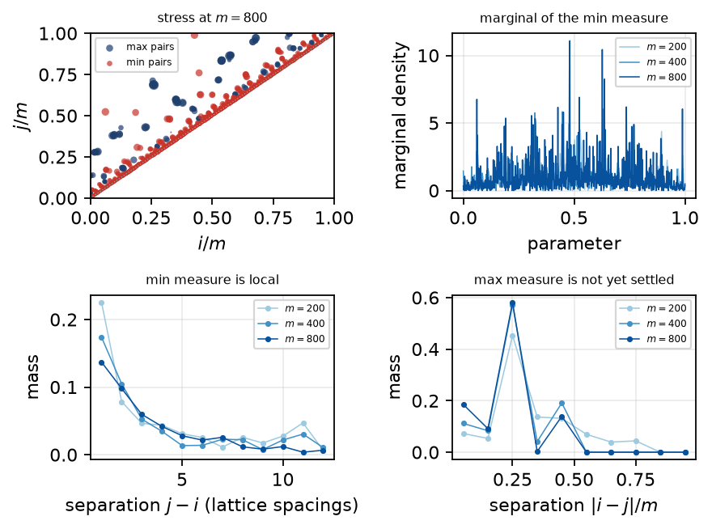

# Uneven parameter spacings — preliminary

**Notation.** In `notes/koch-extremals.tex` $\rho$ is the distortion ratio $|F(x)-F(y)|/|x-y|^\alpha$;
here $\kappa$ is used for the *gap ratio* $\max\Delta x/\min\Delta x$, to keep the two apart.

**Status.** Preliminary, deliberately not in either note (`notes/improving-koch-extremals.tex` had a
paragraph and figure on this and they were removed on 2026-11-16; the history still has them). To be
written up only once we agree what the facts are. Scripts: `scripts/optimise_uneven.py`,
`scripts/uneven_spacing.py`, `scripts/analyse_random_spacing.py`, `scripts/plot_uneven.py`,
`scripts/plot_uneven_random.py`. Data: `results/uneven-*.json`, `results/uneven_*.npz`.
Figures: `figures/uneven-spacing.png`, `figures/uneven-random-shapes.png`,
`figures/uneven-random-diagnostics.png`.

The problem with free parameters: $0=x_0<\dots<x_{m-1}=1$ and $v_i\in\mathbb{C}$, minimise the
spread of $r_{ij}=|v_i-v_j|/(x_j-x_i)^\alpha$ over all pairs.

## 1. Free spacings are degenerate

Three points already give $D=1$ exactly (a triangle with sides $c,c,2^\alpha c$ exists, with
$c=3^{-\alpha}$). Splitting them into near-duplicates — $\varepsilon$ apart in parameter and
$c\,\varepsilon^\alpha$ apart in space — keeps every ratio at 1, so the infimum is $1$ for every
$m\ge3$, approached only as the duplicates coalesce, and no curve is approximated. The optimiser
finds exactly this: $D=1.0008$ at $m=6$, gaps from $2.5\times10^{-5}$ to $0.56$, the six points in
three pairs. **The free problem is empty**; every statement below needs a constraint on the gaps.

## 2. Bounded gap ratio $\kappa=\max\Delta x/\min\Delta x$

$\kappa=1$ is the uniform ladder. For each fixed $\kappa$ the compactness argument still gives
$D_m(\kappa)\to D_\infty$, since comparable gaps keep the parameters asymptotically uniform.

```
          m=8      m=12     m=16     m=24     m=32     m=48     m=64     m=96
 rho=1   1.15661  1.22013  1.24535  1.29708  1.33192  1.37189  1.40031  1.43403
 rho=2   1.15012  1.20140  1.23488  1.28427  1.31850
 rho=4   1.11664  1.18004  1.21941  1.27031  1.30524
 rho=8   1.09427  1.15733  1.18935  1.25117  1.28663
 rho=16  1.08978  1.13516  1.17524  1.23142  1.27044
 rho=32  1.06277  1.09517  1.16348  1.20199  1.26423
```

Unevenness lowers every rung by a few per cent. The optimal spacings are *hierarchical*, not smooth:
at $\kappa=32$, $m=32$ the gaps alternate between $0.0026$ and $0.082$ — clusters of near-duplicates
separated by jumps of the maximal size (`figures/uneven-spacing.png`, right panel). Imposing a smooth
profile instead is catastrophic: $x_i=(i/(m-1))^{1/2}$ gives $D=5.14$ at $m=12$ and
$x_i=(i/(m-1))^{2}$ gives $11.16$, against $1.22$ for uniform. It is the *structure* of the
unevenness that matters, not its size.

## 3. Random fixed spacings

$x_i$ = sorted uniform random, then frozen; only the positions are optimised. Three draws,
$m=16\dots64$.

```
   m     uniform    draw 0    draw 1    draw 2      gap ratio (draws)
  16     1.24535   1.21758   1.20414   1.21832      47 - 288
  24     1.29708   1.26336   1.26667   1.27676      48 - 216
  32     1.33192   1.29296   1.27874   1.30292     212 - 2199
  48     1.37189   1.34271   1.34781   1.34688     155 - 1934
  64     1.40031   1.36897   1.35468   1.37138      86 - 1319
```

Two things. **Random spacings beat the uniform grid at every $m$**, by 2–3%: the uniform
parametrisation is a poor sampling of the extremal curve, not the best $m$-point sampling. And the
values still increase with $m$, as they must ($D_m\le D_{m+1}\le D_\infty$).

**The shapes do not separate.** `figures/uneven-random-shapes.png` shows draw 0 at $m=16,32,64$
against the $m=800$ uniform configuration (grey). The coarse configuration is a polygon whose
vertices sit on the same S profile; by $m=64$ the points hug it. No second shape appears.

Quantitatively, with the conjugation ambiguity resolved by taking the better of $v$ and $\bar v$:

* max distance from a configuration to the $m=800$ polyline: random draws $0.045$–$0.11$
  (mean $0.013$–$0.053$); uniform rungs $0.034$–$0.12$ (mean $0.010$–$0.051$). The same range,
  falling with $m$ in both (`figures/uneven-random-diagnostics.png`, right).
* shape distances (max point-to-polyline, both directions) between the three $m=64$ draws:
  $0.068$, $0.069$, $0.081$. Between a draw and the uniform $m=64$: $0.054$, $0.081$, $0.085$.
  Between uniform rungs themselves ($m=96$ vs $m=800$): $0.054$.

So at these $m$ all the configurations, uniform and uneven, sit in one shape class to within
$0.05$–$0.08$ of the diameter: the same S profile, unevenly sampled and further along.

**A caution about the test.** "Qualitatively different from the exactly self-similar curves we have
looked at" would not by itself indicate a new type of optimum: the *uniform* S family is already not
self-similar in the measured sense (best sub-arc similarity residual $0.13$,
`results/shortening-similarity.md`). Differing from Koch, the two-piece and the three-piece arcs is a
property of the S branch already.

## 4. Caveats, and what would settle it

* All values are local optima from a few starts. At fixed $\kappa$ they are not monotone in $m$
  ($\kappa=32$: $1.0628$ at $m=8$, $1.0952$ at $m=12$), which cannot happen for exact optima. Seeding
  $m=12,16$ from the $m=8$ optimum improves them slightly ($1.1352\to1.1223$, $1.1635\to1.1516$) but
  not to $1.0628$.
* The shape test is limited by not knowing the limit curve: the uneven configurations are *better*
  than the $m=800$ uniform one, so they cannot coincide with it, and the distance to it is a crude
  proxy.
* What would decide it: run the random-spacing family to $m\approx200$–$400$ and see whether the
  pairwise shape distances keep falling ($0.07$ at $m=64$, against $0.054$ between uniform rungs at
  $m\ge96$); or compare sampling *densities* (the parameter measure) rather than point sets; or run
  the sub-arc self-similarity diagnostic directly on the uneven optima, which is the test that
  distinguishes "a different kind of optimum" from "a different sampling of the same curve".

## 5. Is the gain "just the prevalence of large arcs"?

Suggested hypothesis: at fixed $m$ an uneven parametrisation might win simply because it offers
long parameter spans whose ratios are slack, i.e. because "large arcs" are prevalent. The data says
no, on three counts (all at $m=32$ unless stated).

**The optimiser does not make large arcs.** At $\kappa=32$ the longest gap is $2.5\times$ the mean gap
($0.082$ against $0.032$) and the shortest is $0.08\times$: it *clusters* points, it does not open
long arcs. Across $m=8\dots32$ at $\kappa=32$ the largest gap is $2.4$–$4.8\times$ the mean.

**The gain does not need them.** Gaps confined to $[0.65,1.4]\times$ the mean ($\kappa=2$, so no long
arcs at all) already recover $7$–$20\%$ of the $\kappa=1\to32$ gain, $\kappa=4$ recovers $28$–$43\%$ and
$\kappa=16$ recovers $68$–$91\%$; the gain grows roughly linearly in $\log\kappa$ with no threshold.

**The binding pairs are not the long ones.** At $m=32$:

```
                     D        max r at span   min r at span    r over spans<0.05   r over spans>0.5
 uniform          1.33192    0.387 (1.1x)     0.452 (1.3x)       0.789-0.938        0.789-1.050
 rho=2            1.31850    0.641 (1.8x)     0.535 (1.5x)       0.787-0.924        0.787-1.038
 rho=32           1.26423    0.805 (1.9x)     0.538 (1.2x)       0.825-1.043        0.825-1.043
 random draw 0    1.29296     -                -                  0.804-1.038        0.804-1.039
```

(spans in ordinary units, with "x" the span divided by the mean span of all pairs.)

The binding ratios sit at spans of $1.1$–$1.9\times$ the mean in every case --- never at the longest
arcs --- and the long-span ratios are if anything *narrower* than the rest, not slack in a way that
helps.

**What the gain actually is.** It is a rise of the *minimum* ratio: the smallest ratio goes from
$0.789$ (uniform) to $0.825$ ($\kappa=32$), while the largest barely moves ($1.050\to1.043$). In the
uniform optimum the short-span pairs sit at the bottom of the ratio range ($0.789$--$0.938$ for spans
below $0.05$, against $1.050$ for long spans): the small-scale chords are systematically too short.
Uneven spacing lets the finite configuration place its points so that short and long spans have the
*same* ratio range ($0.825$--$1.043$ in both), i.e. it equalises across scales at fixed $m$, which the
uniform grid blocks. The correlation between $\log$ span and $\log$ ratio barely changes
($+0.54$ uniform, $+0.48$ at $\kappa=32$), so this is a shift of the ratio range, not a change of
structure.

In short: the lower $D$ is a *sampling* effect, as suspected, but the mechanism is the extra freedom
to place the points (which removes a scale bias), not the presence of long arcs. Since every fixed
$\kappa$ still has $D_m(\kappa)\to D_\infty$, it buys rate of convergence, not a different limit.
Caveat: this diagnostic is at $m=32$; it should be repeated at the largest $m$ we can afford.

## 6. Larger tests: how should the nodes be placed?

Measured at $m=32$ and $m=64$ with the positions optimised in every case (two restarts each), on the
same objective:

```
                        m=32      m=64     gain vs uniform (m=32 / m=64)
 uniform grid          1.33242   1.40031   --
 jittered, one node
 per stratum (3 seeds) 1.31787   1.39011   1.1% / 0.7%
                       1.32392   1.39341   0.6% / 0.5%
                       1.32308   1.39243   0.7% / 0.6%
 iid uniform (3 draws) 1.27874   1.35468   4.0% / 3.3%
                       1.29296   1.36897   3.0% / 2.2%
                       1.30292   1.37138   2.2% / 2.1%
 smooth warp gamma=0.95 1.33338 1.39982   ~0
 smooth warp gamma=1.10 1.33311 1.40081   ~0
```

Read off:

* **i.i.d. draws are not the right instrument for a study of the optimum.** They are a typical
  sampling, but the optimised $D$ then scatters by about $1\%$ between draws --- the same size as
  the effects one wants to resolve --- and most of that scatter is sampling noise, not geometry.
* **Jittering/repelling the nodes** (one node per stratum, so the gaps stay within a factor of a few)
  reduces the scatter to about $0.5\%$, but it also gives back most of the gain: it pushes the
  sampling back towards uniform.
* **Smooth changes of density do nothing.** Warps $x_i=(i/(m-1))^\gamma$ with $\gamma$ within $10\%$
  of 1 (gap ratio 1.25--1.7) reproduce the uniform value to four digits. The gain is *local*
  unevenness (clusters), not a global reweighting.

What matters is the sampling *density* (the empirical measure), not the individual gaps. Hence, for
larger tests: use a **deterministic** grid --- either a quantile grid of a density,
$x_i=Q(i/(m-1))$, or better, the $\kappa$-bounded family already implemented ($\kappa=4$ or $8$,
grown in $m$). That is noise-free, stays non-degenerate (so $D_m\to D_\infty$ by compactness applies),
and lets the optimiser put the local unevenness where it wants it.

## 7. Does coupled annealing in $(\beta,m)$ reach $D_\infty$?

Partly, and not on its own.

* **The coupling is mild.** The surrogate is a log-sum-exp over $m(m-1)/2$ pairs, so its bias is
  $O(\log m/\beta)$: for a fixed relative accuracy $\varepsilon$ one needs $\beta\gtrsim2\log m/\varepsilon$.
  $\beta$ should grow like $\log m$, not like $m$. Annealing $\beta$ is what makes each level
  optimisable from the previous one; it does not sharpen the answer beyond $\varepsilon$.
* **It does not remove the real difficulty,** which is that the number of local minima grows with $m$
  and that the algorithm is a descent method at each level. The exact values $D_m$ are what converge
  ($D_m\uparrow D_\infty$), so a coupled scheme is only as good as the optimisation at each $m$
  (in practice: double $m$, interpolate, polish with the SLP to a KKT point).
* **It must not be run on free spacings.** The free problem's infimum is $1$ for every $m$
  (\S1), so a $(\beta,m)$ annealing with free spacings converges to the degenerate value $1$, not to
  $D_\infty$. It has to live in a non-degenerate class: uniform, or gap ratio bounded, or a fixed
  asymptotic density.
* **Extrapolation in $m$ is not usable yet.** The ladder's increments per doubling are
  $0.084, 0.055, 0.051, 0.048, 0.046$ --- decaying by only $0.94$ per doubling. A power-law fit
  $D_m=D_\infty-cm^{-s}$ to the six rungs gives $D_\infty=2.16$, $s=0.116$, residuals $\sim10^{-3}$
  --- and $2.16$ exceeds the proved Koch ceiling $2.0968$, so the fit is impossible and the ladder is
  in a transient. No extrapolation from $m\le1600$ can settle the continuum value.

So: the sensible version of the idea is "$\beta\sim\log m$, $m$ doubling, exact (or certified)
polishing at each level, inside a non-degenerate spacing class", and it delivers a *sequence of
bounds*, not the limit. For the actual continuum value the more promising route is the continuum
stationarity structure (stress measure, variational inequality) that the earlier sessions started,
with a refinement scheme that inserts points where the stress concentrates --- that converges to a
stationary point of the continuum problem rather than crawling up the $m$-ladder.

## 8. The $\kappa=4$ family at large $m$ (200, 400, 800)

Deterministic, warm-started (`scripts/uneven_large.py`, results `results/uneven_k4_m*.npz`,
`results/uneven-kappa4-large.json`, `results/uneven-kappa4-m400.json`,
`results/uneven-kappa4-m800.json`). Gaps and positions both optimised, gap ratio bounded by 4;
every run uses the full bound (gap ratio 3.45–3.69), so the constraint is active, not a near-uniform
optimum. $m=800$ costs 6.3 min against 78 s at $m=400$, on the same five warm starts.

```
   m       32        64        96        128       200       400         800
 kappa=4  1.30524   1.38756   1.42510   1.45258   1.48548   1.53749     1.58638
 uniform  1.33192   1.39536*  1.43403   -         1.49086   1.54179     1.59003
 gain     3.6%      0.56%     0.52%     -         0.36%     0.28%       0.23%
```
(*interpolated in $\log m$ between the uniform rungs.)

* The gap between the two families **shrinks**: $3.6\%$ at $m=32$, $0.5$–$0.6\%$ at $m=64$–96,
  $0.2$–$0.4\%$ at $m=128$–800. So the unevenness buys a *transient* advantage, as it must if both
  families converge to the same $D_\infty$.
* **The increments do not decay faster.** Per doubling of $m$: $\kappa=4$ gives
  $0.082, 0.064, 0.066, 0.051, 0.052, 0.049$; the uniform ladder gives
  $0.064, 0.055, 0.051, 0.048, 0.046, 0.048$. At matched $m$ the two are the same to about $0.005$.
  The $m=800$ rung is the first place they can be compared over two clean doublings: successive
  increments have ratio $0.940$ ($\kappa=4$) against $0.947$ (uniform), i.e. the same decay to
  within $1\%$, which is no evidence that bounding the gap ratio buys a better *rate*. The
  $\kappa=4$ ladder simply sits lower, and because its increment is still the larger of the two at
  $m=800$ the gap between the families is still closing ($0.36\%\to0.28\%\to0.23\%$).
* **Extrapolation.** A fit $D_m=D_\infty-cm^{-s}$ gives, for $\kappa=4$,
  $D_\infty=1.768$, $c=1.19$, $s=0.273$, residuals $\le0.0025$; for the uniform ladder
  $D_\infty=2.161$, $s=0.116$, which is **inadmissible** ($2.161>2.0968$, the proved Koch ceiling).
  The $\kappa=4$ extrapolation is plausible but should not be trusted: the model is arbitrary, the
  residuals are comparable to the whole gap between the families, and $s$ is fitted to five points.
  The $m=800$ rung does not help the fit: read locally, the last increment ratio gives
  $s=-\log_2 0.940=0.089$, against $0.273$ from the five-point fit, so $s$ is not identified at all
  over the range we can reach and neither $D_\infty=1.77$ nor any other extrapolated value should
  be quoted.
  What it does say is only that the $\kappa=4$ fit can at least be made admissible, whereas the
  uniform one cannot: it is not a licence to read off $D_\infty$.
* **Noise.** Repeated runs at $m=200$ differ by $0.0016$ ($1.48380$ against $1.48548$), i.e. $0.1\%$;
  the $m=400$ and $m=800$ values are single runs. So the $0.2$–$0.4\%$ gaps at large $m$ are at the
  edge of what this optimiser resolves, and the trend (shrinking gap) is the part to trust, not the
  individual numbers.

## 9. What exactly is the "stress measure"

Two levels; the finite one is implemented (`slp2.stress`), the continuum one is a programme.

**Finite $m$.** Free coordinates $x\in\mathbb{R}^{2(m-2)}$ (positions after the similarity gauge), and
for each pair $a=(i,j)$ the log-ratio $L_a(x)=\log r_{ij}=\log|v_i-v_j|-\alpha\log|i-j|$. The problem
$\min_x\ \max_a L_a-\min_b L_b$ has the KKT conditions: there are weights
$\lambda\in\Delta(E^+)$, $\mu\in\Delta(E^-)$ on the tight sets
$E^+=\{a:L_a=\max L\}$, $E^-=\{b:L_b=\min L\}$ with
\[
  \sum_{a\in E^+}\lambda_a\nabla L_a \;=\; \sum_{b\in E^-}\mu_b\nabla L_b ,
\]
and each $\nabla L_a$ is supported on the two endpoints of $a$ with value
$\pm(v_i-v_j)/|v_i-v_j|^2$ — a unit vector along the chord divided by its length. So the certificate
is a *pair of probability measures on the tight pairs* whose fields balance at every free vertex:
$\lambda$ pulls along the longest chords, $\mu$ pushes along the shortest. `slp2.stress` solves
exactly this feasibility LP (status 0 = a certificate exists); that is what "first-order certified"
means in Table 1. At $m=200$ it is $48+346$ pairs, at $m=400$ it is $80+695$ (arc branch) — thousands
of coefficients, so the measures are far from unique.

**Continuum.** A pair of Borel probability measures $\sigma^+$ on $[0,1]^2$ supported on
$E^+=\{(x,y):r(x,y)=M\}$ and $\sigma^-$ supported on $E^-=\{(x,y):r(x,y)=m_0\}$, such that for every
test field $\psi\in C_c((0,1);\mathbb{R}^2)$
\[
  \iint \psi(x)\cdot\Phi(x,y)\,d\sigma^+(x,y) \;=\; \iint \psi(x)\cdot\Phi(x,y)\,d\sigma^-(x,y),
  \qquad \Phi(x,y)=\frac{\gamma(x)-\gamma(y)}{|\gamma(x)-\gamma(y)|^2},
\]
i.e. the first variation of $M$ and of $m_0$ agree in every direction — the curve is a stationary
point of the minimax. Equivalently, with $\sigma=\sigma^+-\sigma^-$, the stress field
$S(x)=\int\Phi(x,y)\,d\sigma_x(y)$ vanishes (Lebesgue-a.e. $x$), where $\sigma_x$ is the
disintegration at $x$.

Two points of care. (i) $|\Phi|\sim|x-y|^{-\alpha}\to\infty$ on the diagonal, so the integrals are
principal values: the equation only makes sense if $\sigma^+$ and $\sigma^-$ have matching
short-distance behaviour near $y=x$. That is not an artefact — the numerics show the extrema
recurring at *every* scale (contiguous blocks of the $m=400$ configuration reproduce $D$ to
$1.2\times10^{-13}$), so mass genuinely accumulates on the diagonal, and the balance has to be
imposed scale by scale. (ii) The multipliers are not unique at these $m$ (thousands of tight pairs,
highly degenerate LP), so the continuum statement requires a canonical selection — the earlier
session used a least-TV selection; weak-* convergence of the selected measures along a
shape-compatible branch is the test that was proposed and not carried out
(`results/limiting_curve_directions.md`).

**What one would do with it.** Compute $(\lambda,\mu)$ at each $m$ (a small LP), read the marginals
on the index $i$, and insert points where the marginal mass or the residual $|S(x)|$ is largest:
an adaptive refinement driven by the stress, which converges to a stationary curve instead of
crawling up the $m$-ladder. Nothing of this is carried out; the finite LP is the only part that
exists in code.

## 10. Is there a stress for the Koch curve?

The stress is a KKT certificate: if it exists, no first-order variation of the curve lowers $D$, and
by Farkas the converse holds, so *stress exists* $\iff$ *no first-order descent direction*. It
certifies local optimality in the space of curves; it says nothing about other branches, and at a
non-smooth min like this one the directional derivative is typically *positive* in most directions,
so "D increases in every direction I tried" is consistent with stationarity and decides nothing.
The only test is the LP (finite) or its continuum analogue.

**Finite level: no certificate, and explicit descent.** At every dyadic level the Koch polygon
(parameters $x_i=i/4^k$, so exactly the uniform-index configuration of $m=4^k+1$) fails the LP, and
the imbalance is not small — `scripts/stress_residual.py` minimises the L1 residual of
$\sum\lambda_a A_a=\sum\mu_b A_b$ over $\lambda,\mu\ge0$, $\sum\lambda=\sum\mu=1$ and divides by the
mean row norm of $A$:

```
 level  m      D            residual   #max  #min   D after 1 SLP step   after 5
   2    17    2.083010     1.953       6     1        2.080516            2.007973
   3    65    2.089552     1.784       6     8        2.088688            2.062924
   4    257   2.093439     1.106       6     39       2.092876            2.080642
   5    1025  2.0968052    1.080      12     166      -                   -
   6    4097  2.0968052    0.405      72     677      -                   -
```

The residual is insensitive to the tolerance defining the tight sets ($10^{-6}$ to $10^{-10}$ give
identical values) and to nothing else, so the sets really are tight. So at every level tested the
Koch polygon is *not* a local minimum of the finite-$m$ problem, and the SLP reduces $D$ at once.

**But that is a different condition.** The finite-$m$ gradient sees only *node* pairs, while the
continuum sup is over all pairs; a discrete descent direction can leave the continuum functional
untouched (or worse). And the residual *falls* under refinement, $1.95,1.78,1.11,1.08,0.41$, as the
extremal sets grow ($6\to12\to72$ max pairs, $1\to677$ min pairs) and give the multipliers more room.
So the finite data are **inconclusive** about the continuum.

**A two-parameter family test, also inconclusive.** Four-piece self-similar arcs with weights
$w=(w_1,w_2,w_2,w_4)$, sidelengths $r_i=w_i^{\alpha}$ and Koch directions $(0,\theta,-\theta,0)$,
closure forcing $\cos\theta=(1-r_1-r_4)/(r_2+r_3)$: the Koch curve is $w=(1/4,\dots,1/4)$. At level
6, $D$ increases in every direction tried, with slopes $\partial D/\partial w_1\approx+3.7$,
$+7.5$ along $(w_1,w_4)=(1,1)$ and $+0.05$ along the anti-diagonal $(1,-1)$: so the Koch curve is a
local minimum *within this family*, pointy rather than smooth. That is what a KKT point that is not
smooth looks like, so it does not answer the question either.

**Resolved in §12:** the descent exists. The argument below is therefore moot as a programme; it
is kept because the diagnostic it describes (the multiplier residual) correctly predicted
non-stationarity.

**What would.** The Koch extremal pairs are explicit (the orbit of the two seeds under the four
maps, at all scales), so a continuum stress would be a *self-similar pair of measures* on their
addresses, and the balance at a test point becomes a countable linear system obtained by
renormalisation: the same kind of computation as the companion note's two-sided proof, one level up
(there it was a range; here it is a linear system for the weights). Truncating at level $K$ and
watching the residual $0.41$ at $K=6$ either decay geometrically (then the limit is plausibly
feasible and the measure can be constructed) or not. This has not been done.

Nothing here changes any bound: a stress at Koch would make it a critical point of $D$, and since
other curves do better ($2.0179$ measured, S-ladder about $1.5$--$1.6$) it would be a saddle, not a
minimiser.

## 11. The growth plot, and i.i.d. spacings up to $m=400$


`figures/uneven-ladder.png` (from `scripts/plot_uneven_ladder.py`). Left: best $D_m$ against $m$,
one curve per gap-ratio bound, $\kappa=4$ carried to $m=800$, the polished uniform ladder dashed, and
the i.i.d. family in black. Right: the increment per doubling, $\Delta D$ against $m$, with the
power-law fit $cm^{-0.27}$ to the $\kappa=4$ ladder as a dotted guide.

Read-offs:

* at fixed $m\le32$ the ordering in $\kappa$ is strict and monotone (at $m=32$: $1.332, 1.319,
  1.305, 1.287, 1.270, 1.264$ for $\kappa=1,2,4,8,16,32$), i.e. more allowed unevenness, lower $D$;
* the $\kappa=4$ curve runs into the uniform one as $m$ grows (gap $3.6\%$ at $m=32$, $0.28\%$ at
  $m=400$, $0.23\%$ at $m=800$) --- the advantage is spent;
* nothing decelerates enough to extrapolate: the increments fall from $0.086$ to $0.049$ per
  doubling over $m=24\dots800$ ($\kappa=4$) and from $0.064$ to $0.048$ over $m=40\dots1600$
  (uniform).

**i.i.d. spacings, $m$ up to 400.** $x_i$ drawn uniformly at random and frozen, positions optimised,
three draws at each $m$ (two at $m=400$), `scripts/uneven_random_homotopy.py`. Plain L-BFGS from a
uniform start is not usable above $m\approx100$ here --- gap ratios of $10^3$--$10^4$ make the problem
stiff and the draws spread by $4.7\%$ ($1.486$--$1.556$ at $m=200$) --- so the spacings are moved
from uniform to the target in five steps, re-optimising at each. That is the difference between the
two columns below.

```
   m     uniform    kappa=4    i.i.d. (3 draws)          i.i.d. spread
  100    1.43623    1.42510*   1.41052  1.40475  1.40885   0.4%
  200    1.49086    1.48548    1.46909  1.46381  1.47038   0.5%
  400    1.54179    1.53749    1.52217  1.52063   -         0.1%
```
(*at $m=96$; the $\kappa=4$ run at $m=100$ was not made.)

So i.i.d. is the lowest of the three families at every common $m$: taking the best draw, it is
below uniform by $2.2\%$, $1.8\%$, $1.3\%$ at $m=100,200,400$, and below $\kappa=4$ by $1.5\%$ and
$1.1\%$ at $m=200,400$. And the draws agree to
$0.1$--$0.5\%$ once the homotopy is used, which is what makes the comparison meaningful.

The ordering i.i.d. $<$ $\kappa=4$ $<$ uniform at every $m$ is what §5 predicts: more allowed
unevenness, lower $D$ at fixed $m$, by a diminishing amount. It is still a *sampling* effect --- the
shapes are the same S curve (§3) --- and all three families are legitimate discretisations
(asymptotically uniform sampling), so they share the limit and differ only in rate. Whether the
i.i.d. rate is genuinely better or only looks so at these $m$ cannot be settled from three points:
its increments are $0.059$ ($m=100\to200$) and $0.057$ ($200\to400$), a decay ratio of $0.96$ per
doubling, the same as the uniform ladder's $0.95$.

## 12. Does the two-piece arc (2.042) imply a descent at Koch? Yes --- Koch is the $t=\tfrac12$ member

**The answer.** The two-piece construction of §2 of the note,
$\gamma(x)=b_0\overline{\gamma(x/t)}$ for $x\le t$ and $\gamma(x)=1+b_1\gamma((1-x)/(1-t))$ for
$x\ge t$, with $|b_0|=t^\alpha$, $|b_1|=(1-t)^\alpha$, $b_0-b_1=1$, has $t$ free. At $t=\tfrac12$
both weights are $\tfrac12$ and both ratios $2^{-\alpha}=1/\sqrt3$, and the construction *is* the
Koch curve --- reflected in the real axis, which is a similarity. So the family carrying the
$2.042$ champion also carries Koch, and sweeping $t$ gives

```
      t        D(t) (level 10)      D - D(Koch)     one-sided slope
    0.4800    2.110404820         +1.36e-02
    0.4900    2.103279096         +6.5e-03         -0.78
    0.4990    2.097583106         +7.8e-04         -0.78  (from below)
    0.5000    2.096805161          0               -
    0.5010    2.096248775         -5.6e-04         -0.56  (from above)
    0.5100    2.090092792         -6.7e-03         -0.56
    0.5400    2.063943913         -3.3e-02
    0.5630    2.041469           (deep-level 2.04204)    minimum
```

$D$ is *monotone decreasing* through $t=\tfrac12$, with the slope changing across the Koch point from
$-0.78$ (below) to $-0.56$ (above): the extremal pairs reorganise there, but the descent is first
order on both sides. **Hence there is a first-order descent direction at the Koch curve, no stress
exists, and Koch is not even a stationary point of the distortion functional.** The finite-level
multiplier residuals of §10 ($1.95,1.78,1.11,1.08,0.41$) were telling the truth.

**That $t=\tfrac12$ is really Koch**, not something with the same distortion: the minimum and maximum
ratios there are $0.48346$ and $1.01372$, i.e. the two sharp constants $2\cdot6^{-\alpha}$ and
$2\sqrt{211}\cdot69^{-\alpha}$; and the level-10 nodes coincide with the Koch dyadic nodes to
$4\times10^{-3}$ after conjugating (the residue is the parameter-grid mismatch of the two
enumerations, not a geometry difference).

**Why the obvious objection fails.** Koch is a four-branch arc (weights $\tfrac14$, ratios
$\tfrac13$, directions $0,60^\circ,-60^\circ,0$, no reflection) against a two-branch one with
unequal weights, a reflection and a reversal, so the first guess --- that no family contains both,
the branch data being discrete --- looks right and is wrong: because the Koch curve satisfies
$F(1-u)=1-\overline{F(u)}$, a reversal can be traded for a reflection, and the two-branch normal form
contains Koch at equal weights. That is the observation that produced this section.

**Two traps to record.** (i) Interpolating the two *parametrisations* in shape space,
$\gamma_s=(1-s)F_{\rm Koch}+sF_{2\rm pc}$ on a common uniform grid, does not descend at all ---
$D=2.096805,2.103048,2.115649,2.160984,2.302097,16.29$ at $s=0,0.001,0.003,0.01,0.03,0.3$ --- it
ascends immediately and blows up, because the two curves are very different and the convex
combination develops tiny chords. A path has to stay inside the family. (ii) $D$ depends on the
parametrisation: the two-piece arc's $2.042$ is in *its own* self-similar parametrisation, and the
same point set on the uniform parameter grid scores $2.652$. So "$2.042<2.097$" compares two
admissible arcs each in its natural parametrisation --- legitimate, but not a path, and on its own
it identifies no direction at Koch.

**What this does not change.** Koch remains the only *proved* explicit bound at $2.0968$. What changes
is that it is not a critical point of the distortion functional: the functional has a kink there, and
following the descent leads to the two-piece arc at $t\approx0.563$, $D=2.042$. For the stress
programme the lesson is that continuum stationarity is sensitive to where the extremal pairs sit, so
the families worth testing are those that vary the branch data of a self-similar curve, not
interpolations in shape space.

## 13. The stress at $m=200,400,800$, and whether it approximates a continuum stress



`figures/stress-measures.png`, from `scripts/stress_plot.py` (data `results/stress-maxent.npz`).

**The selection has to be canonical.** `slp2.stress` returns *a* vertex of the multiplier polytope;
at these $m$ the polytope has hundreds of tight pairs and the vertex depends on the order the pairs
happen to be listed in, so plotting it is meaningless. The canonical choice used here is the
maximum-entropy point: maximise $-\sum z\log z$ over $\lambda,\mu\ge0$, $\sum\lambda=\sum\mu=1$,
$A_+\lambda-A_-\mu=0$, computed exactly through its smooth dual (Newton, constraint residual
$\le2\times10^{-12}$). It does not depend on pair ordering. Tight sets: $48+346$, $70+706$,
$147+1408$ at $m=200,400,800$.

**What it looks like.** Panel (a), $m=800$: the minimum measure (red) hugs the diagonal — it is a
*local* measure — while the maximum measure (blue) is spread over separations of order $0.1$--$0.5$.
Panel (c) makes the first statement quantitative in lattice units: mass $0.22,0.17,0.14$ at separation
one, then $0.10,0.08,0.10$ at two, $0.05$ at three, decaying by about a factor two per spacing. Panel
(d): the maximum measure sits at separations of order $0.3$ with a secondary bump near $0.5$, and both
the peak position and the shape shift with $m$.

**Can these be read as the continuum stress?** Partly, and not yet.

* *The minimum part cannot converge as a measure on $[0,1]^2$.* Its median separation is
  $0.005,0.005,0.003$ at $m=200,400,800$, i.e. one or two lattice spacings: as $m\to\infty$ it
  concentrates on the diagonal, where $r(x,x)$ is not defined. The informative object is the
  blown-up description — the law of the separation in units of $1/m$ (panel (c)) — which does decay
  like a fixed profile, $0.22\to0.17\to0.14$ at the first spacing, so there is some hope of a
  rescaled limit, but the profile is still drifting.
* *The maximum part could converge*, and this is where a limit might be visible: it lives at
  $O(1)$ separations. But at $m\le800$ it has not settled — the 2-D histogram (20×20) of the maximum
  measure differs by $L1=0.91$ between $m=200$ and $400$ and $0.61$ between $400$ and $800$, and the
  separation histogram by $0.53$ and $0.39$.
* *The marginal* is the most stable statistic: its 20-bin $L1$ distance falls from $0.21$ to $0.17$
  between consecutive $m$ (panel (b)), still dominated by the spiky fine structure.

**Theory.** At a continuum minimiser a stress *does* exist: $D=M/m$ is locally Lipschitz on the
space of bi-Hölder arcs, so at any local (hence any global) minimiser $0\in\partial D$ in Clarke's
sense, and the Clarke subdifferential is generated exactly by convex combinations of the
$\nabla(r_a/r_b)$ over the tight pairs — which is the stress condition. So the object one is aiming
at is guaranteed; the open question is whether the canonically selected finite-$m$ measures converge
to it, which is the test the earlier session proposed (weak convergence of selected multiplier
measures along a shape-compatible branch).

**What would make them approximations.** (i) Fix the selection, as here. (ii) Split the problem at
its two scales: describe the local (minimum) part in blown-up coordinates, separation in units of
$1/m$, and test *that* law for convergence; describe the global (maximum) part as a measure on
$[0,1]^2$ and test weak convergence with smooth test functions. (iii) Expect a *fragmented* limit —
the support is $O(m)$ pairs out of $O(m^2)$, so the limit measure is likely singular, and pointwise
comparison of densities will never look convergent. (iv) Use the stress as a refinement driver
rather than a picture: insert points where the marginal mass or the residual is largest, which is
the adaptive scheme of §9.

### Is the stress better behaved on uneven nodes?

The plot above is the *uniform* ladder, and the uneven experiments do converge faster in $D$. So it is
natural to ask whether the stress is cleaner there. As stated below, the uneven optima have no
stress; but that is because they were never polished, and the polished question is *not settled* ---
see the end of this section.

`scripts/stress_uneven.py` reuses the same machinery with only `loggap` changed to
$\log(x_j-x_i)$, so `grad_rows`, the SLP and the multiplier LP all apply to an uneven configuration
as they stand. Result, at tolerance $10^{-8}$ on $\log r$:

```
  configuration        D            KKT status   tight pairs
  kappa=4   m=200      1.485475300      2            1 + 1
  kappa=4   m=400      1.537491238      2            1 + 2
  i.i.d.    m=200      1.469092211      2            1 + 1
  i.i.d.    m=400      1.522169560      2            1 + 2
  uniform   m=200      1.490855260      0           48 + 346
  uniform   m=400      1.541792000      0           70 + 706
```

The uneven optima have a *single* longest chord and one or two shortest, so the multiplier LP is
infeasible at every tolerance tested ($10^{-9}$ to $10^{-4}$); the uniform ones have the marginal
contact of §9 (hundreds of ties) and a certificate. The reason is structural: with free spacings the
optimiser can isolate the extremal chords instead of tying them, and that is exactly why it reaches a
lower $D$ at fixed $m$ --- it escapes the rigidity that forces thousands of ties. But the same escape
means there are no multipliers to plot: the uneven family is better for *values* and empty for
*stress*.

**The polishing test, and why the conclusion above is provisional.** A KKT point of the $m$-point
minimax must have at least $2(m-2)+2$ tight pairs --- that many equations for the multipliers ---
i.e. about $2m$: the certified uniform configurations have $48+346=394$ at $m=200$ and
$70+706=776$ at $m=400$, right at the count. The uneven configurations have $1+1$ or $1+2$. So
either they are far from converged or they are not stationary at all. Polishing at *frozen*
spacings, three ways (`scripts/polish_uneven.py`, `scripts/polish_continuation.py`):

* from the $\kappa=4$ configuration, ten rounds of (L-BFGS at $\beta\le10^7$ + SLP, 300 iterations):
  $D=1.4854753\to1.4853659$, still status 2, tight counts $4$--$9$ max, $8$--$24$ min --- the
  configuration keeps creeping down and no contact structure forms;
* SLP-only continuation from the *certified uniform* configuration while the spacings move to the
  $\kappa=4$ target in ten steps: $D=1.4909\to2.73$ and status 2 with $1+1$ ties --- the SLP loses
  the configuration as soon as the spacings move, so the step must be much smaller;
* ten rounds of (gentle L-BFGS $\beta\le10^5$ + SLP) from the uniform shape on the target spacings:
  $D\to1.4866$, status 2, $1+2$ ties --- a different (worse) local minimum than the $\kappa=4$ run's
  $1.4855$, again without contact.

So none of the polishes reaches a stationary point, and all of them leave the tight count at $O(10)$
against the required $\approx2m$. The honest state is therefore: **whether a properly polished uneven
optimum has a stress is open**; what the evidence does show is that polishing from these starts is
slow and does not build the marginal-contact structure. The diagnostic to watch is the tight count
--- a converged uneven optimum must reach $\approx2m$, and none of these runs got past a few dozen.
Row-normalising the gradients was the first thing to try, since $|A_i|=1/\text{chord}$ varies by the
whole chord ratio and wrecks the trust region: `scripts/slp_scaled.py` divides each row by its norm
before building the LP. It changes almost nothing --- from $\kappa=4$, $m=200$ it moves
$D=1.4854753001\to1.4854752648$ in 400 iterations, status still 2, $1+9$ ties. So the stall is not a
scaling artefact of the SLP.

**What the stall looks like.** At the polished points the extremes are *nearly* tied --- at $m=200$,
$\kappa=4$, twenty-six pairs lie within $10^{-6}$ of the largest ratio and hundreds within $10^{-4}$
--- but only one or two are tied exactly. A KKT point needs $\approx2m$ *exact* ties, so the
configuration is sitting where the contact set is about to form and the descent per step is
therefore tiny: any decrease of the worst chord immediately hands the maximum to a pair that is
$10^{-6}$ behind it. That is consistent with every method stalling at the same value to $10^{-8}$
while no certificate exists, and it means the uneven problem at frozen spacings is *ill-conditioned*
rather than that the answer is no.

Two further checks on the unpolished conclusion. The uneven optima come from a smoothed surrogate, so they are only
approximately stationary: the direction that decreases the longest chord and increases the shortest
changes $D$ by $+2.5\times10^{-7}$ for a step of $10^{-6}$, i.e. the two chord gradients are
*nearly* parallel, and an exact-minimax polish in the uneven setting (the SLP with uneven `loggap`)
improves $D$ by $10^{-8}$ in 200 iterations without reaching a certificate. So these points sit on a
kink of $D$ where the smoothed optimiser stopped, not at a multiply-tied stationary point. Whether a
*properly* stationary uneven optimum would have a stress is therefore still open --- but nothing in
the runs so far produces one, and the marginal-contact structure that the stress needs appears to be
a property of the uniform-index problem.

## 14. Repelling nodes: GUE, log-gas, Riesz gas

**Sampling is cheap, at least for $\beta=2$.** The GUE is the $\beta=2$ log-gas on the line, so its
nodes are the eigenvalues of an $n\times n$ Hermitian Gaussian matrix: one `eigvalsh`, $O(n^3)$,
milliseconds at $n\le400$, exact, no MCMC. For hard walls, other $\beta$, or a Riesz exponent, a plain
Metropolis on the gas energy costs $O(n)$ per proposal; $3\times10^3$ sweeps at $n\le200$ is seconds.
Both are implemented in `scripts/repelling_nodes.py`; data in `results/repelling-nodes*.json`.

```
         m=32                m=64                 m=100
 uniform 1.331919            1.403007             1.439499
 Riesz 2 1.3315  1.3322      1.4013  1.4035       1.4388  1.4423
 Riesz 1 1.3297  1.3295      1.4009  1.4055       1.4373  1.4373
 GUE     1.3240  1.3211      1.4011  1.4030       1.4358  1.4401
 log-gas 1.3123  1.2878      1.3739  1.3857       1.4284  1.4291
 i.i.d.  1.3035  1.2907      1.3726  1.3814       1.4075  1.4124
```
(two draws each; positions optimised in every case.)

**Repulsion on its own buys nothing.** The Riesz gases ($\sum|x_i-x_j|^{-s}$, $s=1,2$) reproduce the
uniform value to $0.1\%$: their gap ratios are $1.1$--$2.4$, i.e. the nodes are almost a lattice, and
§5 says that is the one thing that kills the effect --- what pays is *local clustering*, not even
coverage.

**The log-gas is the best of the physical samplers**, and for a density reason: in a box with hard
walls the $\beta=2$ equilibrium density is arcsine, $\propto(x(1-x))^{-1/2}$, which diverges at the
two ends. So it produces genuine strong local unevenness there (gap ratios $30$--$130$) and beats
uniform by $1.5\%$ at $m=32$ and $1\%$ at $m=100$ --- though still short of i.i.d., which is more
uneven everywhere.

**The GUE itself** (eigenvalues rescaled into $[0,1]$) has the semicircle density: sparse at the ends,
dense in the middle. That is a smooth change of density, which §6 found does nothing; it sits between
uniform and the log-gas at $m=32$ and is indistinguishable from uniform by $m=64$.

**So the answer to the suggestion**: a GUE or Coulomb gas will not by itself give a better
repelling sampler for this purpose, because repulsion drives the nodes towards uniformity and the gain
comes from the opposite. If repulsion is wanted, the useful object is the gas *in a box* (log-gas or
sine-kernel near the edges), which mixes repulsion in the interior with the wall singularities; but
then the effect being measured is the edge density, not the repulsion. Everything here is a
finite-$m$ sampling effect; all of these samplers are legitimate discretisations of the continuum
(same shapes, §3), so they can only change the rate.
